<h1 align="center">Filipe Basílio</h1>

<h3 align="center">
  Salesforce Specialist | CRM Consultant
</h3>

  Functional Analysis • Development • Automation • Solutions Architecture

  
  

---

## 👨‍💻 Sobre mim

Profissional de tecnologia com atuação em CRM, arquitetura de soluções, desenvolvimento e automação de processos.

Experiência na administração, manutenção e evolução de plataformas CRM, conectando necessidades de negócio a soluções tecnológicas eficientes, integradas e escaláveis.

- ☁️ Salesforce Specialist & CRM Consultant
- ⚙️ Automação e otimização de processos
- 🔗 Integração entre sistemas e plataformas
- 📊 Análise de dados e indicadores de negócio
- 💻 Desenvolvimento de aplicações e soluções corporativas

---

## ☁️ CRM & Salesforce

---

## 💻 Desenvolvimento & Tecnologias

  

---

## 🎯 Principais competências

- Salesforce Administration
- Functional Analysis & Requirements Gathering
- CRM Solutions Architecture
- Business Process Automation
- Apex, SOQL & Lightning Web Components
- Salesforce Flow & Approval Processes
- REST & SOAP API Integrations
- Reports, Dashboards & Business Intelligence
- Stakeholder Management
- Agile Methodologies & Jira

---

## 🏅 Certificações

---

## 📊 GitHub Analytics

  
  

Updated daily • Language statistics reflect repositories accessible to the analytics workflow.

---

## 🐍 Contribution Activity

<picture>
  <source media="(prefers-color-scheme: dark)" srcset="https://raw.githubusercontent.com/fmariano44/fmariano44/output/github-contribution-grid-snake-dark.svg"/>
  <source media="(prefers-color-scheme: light)" srcset="https://raw.githubusercontent.com/fmariano44/fmariano44/output/github-contribution-grid-snake.svg"/>
  
</picture>

---

  <i>Connecting technology, business and people through intelligent solutions.</i>

